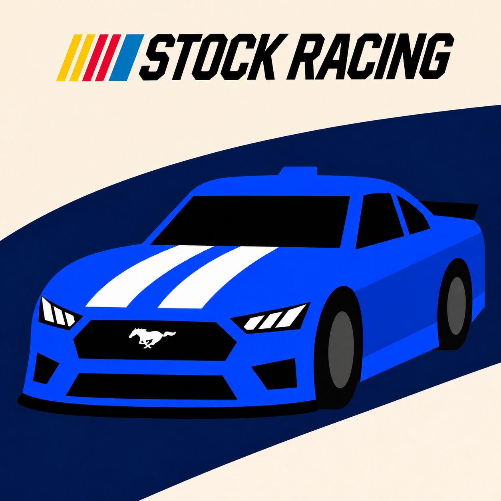
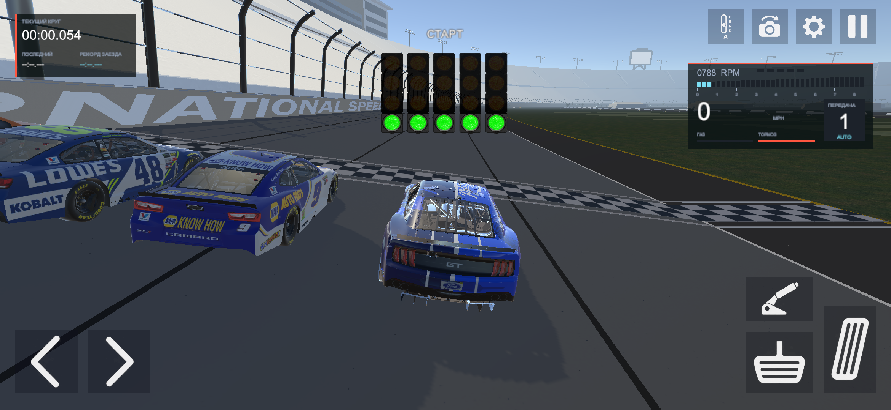
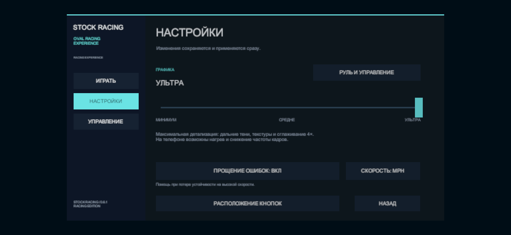
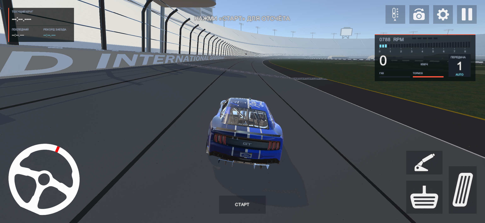

<h1 align="center">Stock Racing</h1>

Гонки на овальной трассе · Unity / C# · Android и ПК

<a href="https://github.com/dcprog992/stock-racing/releases/latest">Скачать Android-демо</a> · <a href="#что-уже-работает">Возможности</a> · <a href="docs/CODE_GUIDE.md">Посмотреть код</a> · <a href="https://github.com/dcprog992/stock-racing/issues">Сообщить об ошибке</a>

**Stock Racing** — мой учебный гоночный проект на Unity, вдохновлённый гонками сток-каров. Здесь можно соревноваться с тремя соперниками или тренироваться с призраком своего лучшего заезда. Акцент — на поведении машины, звуке и ощущении скорости.

Проект находится в разработке. Сейчас доступен **Android-прототип 0.6.2**. ПК-версия разрабатывается в Unity; готовая сборка для Windows пока не опубликована.

## Скачать и попробовать

1. Открой [последний релиз](https://github.com/dcprog992/stock-racing/releases/latest) и скачай `Stock-Racing-Android-v0.6.2.apk`.
2. Установи APK на **Android 8.0+ с процессором ARM64**. Если Android запросит разрешение на установку из выбранного браузера или файлового менеджера, это разрешение нужно дать вручную.
3. Выбери режим, дистанцию и сложность. Подъедь к линии, остановись и нажми **СТАРТ** для отсчёта.

APK весит около **64 МБ**. Контрольная сумма опубликована рядом с ним в `SHA256SUMS.txt` и в [манифесте релиза](release-manifest.json). Это ранний прототип: возможны ошибки и различия производительности на разных телефонах. Физический тест на Samsung S23+ ещё не проведён.

## Что уже работает

- **Два режима:** обычный заезд с тремя соперниками и тренировка с призраком лучшего результата; дистанция — один или три круга.
- **Четыре уровня ИИ:** лёгкий, средний, сложный и хардкор. Сложность влияет в том числе на мощность двигателей. Траектории строятся на основе записанного лучшего круга.
- **Физическая машина:** Rigidbody, WheelCollider, подвеска, стабилизаторы, сцепление, механическая и автоматическая коробка, лаунч-контроль. Настройка максимальной скорости — около 320 км/ч.
- **Обратная связь:** звук двигателя, вой коробки по входному валу, переключения, свист шин, пробуксовка и дым.
- **Повреждения:** деформация кузова, отрыв колёс и дым двигателя при сильных столкновениях.
- **Камеры:** фиксированная, динамическая, из салона и с капота. В салоне работают приборы, руль и зеркало заднего вида.
- **Интерфейс:** стартовый светофор, время и места после финиша, настройки графики, чувствительности и единиц скорости — км/ч или MPH.
- **Мобильное управление:** стрелки или вращаемый пальцем руль; перемещение и изменение размеров кнопок, удержание педали до отпускания пальца.

## Разработка и портфолио

Это мой первый игровой проект. Я задаю направление игры, подбираю материалы, расставляю объекты, проверяю сборки и последовательно дорабатываю поведение машины и интерфейс. Код создаётся и изменяется с помощью **OpenAI Codex**. Готовые модели, трасса и часть звуков — сторонние материалы; я не выдаю их за собственную работу.

В репозитории опубликованы игровые C#-скрипты и материалы портфолио. **Это не полный Unity-проект:** сцены, модели, текстуры и исходные звуковые файлы сюда не включены. Для просмотра архитектуры начни с [путеводителя по коду](docs/CODE_GUIDE.md).

| Подсистема | Реализация |
|---|---|
| Машина и трансмиссия | [CarController](Source/Platforms/PC/CarController.cs), [RacePerformance](Source/Shared/RacePerformance.cs) |
| Заезд, круги, призрак | [SpeedwayRace](Source/Platforms/PC/SpeedwayRace.cs), [TrainingGhost](Source/Shared/TrainingGhost.cs) |
| Соперники | [SpeedwayOpponent](Source/Shared/SpeedwayOpponent.cs), [RaceDifficulty](Source/Shared/RaceDifficulty.cs) |
| Меню и настройки | [GameMenu](Source/Shared/GameMenu.cs), [GameFlow](Source/Shared/GameFlow.cs) |
| Камера и повреждения | [CameraFollow](Source/Shared/CameraFollow.cs), [VehicleDamage](Source/Shared/VehicleDamage.cs) |
| Сенсорное управление | [MobileControls](Source/Platforms/Android/MobileControls.cs), [MobileSteeringWheel](Source/Platforms/Android/MobileSteeringWheel.cs) |

**Технологии:** Unity 6000.6.1f1 · C# · Unity Physics · uGUI · Android ARM64 / IL2CPP.

## Скриншоты

Настройки и мобильный руль

Скриншоты сделаны во время разработки; отдельные детали интерфейса могут отличаться от текущей сборки.

## Дальше

- Выбор карт.
- Доработка поведения и борьбы соперников.
- Оптимизация и тестирование Android на устройствах.
- Дальнейшая настройка машины, звука и интерфейса.

Ошибки и предложения можно оставить в [Issues](https://github.com/dcprog992/stock-racing/issues). Укажи версию игры, модель устройства и шаги для повторения проблемы.

## Материалы и права

Список использованных материалов и границы публикации — в [THIRD_PARTY.md](THIRD_PARTY.md). Репозиторий не предоставляет лицензию на сторонние ассеты. Проект не является официальной игрой NASCAR и не аффилирован с производителями автомобилей или гоночными командами.

---

**English:** Stock Racing is a work-in-progress Unity/C# oval racing prototype. It features physical cars, three AI opponents, time-trial ghosts, manual/automatic transmission, cockpit instruments and customizable Android touch controls. Download the Android demo from [Releases](https://github.com/dcprog992/stock-racing/releases/latest). This repository is a gameplay-code portfolio, not a complete buildable Unity project. Development is assisted by OpenAI Codex; third-party art and audio are not claimed as original work.
